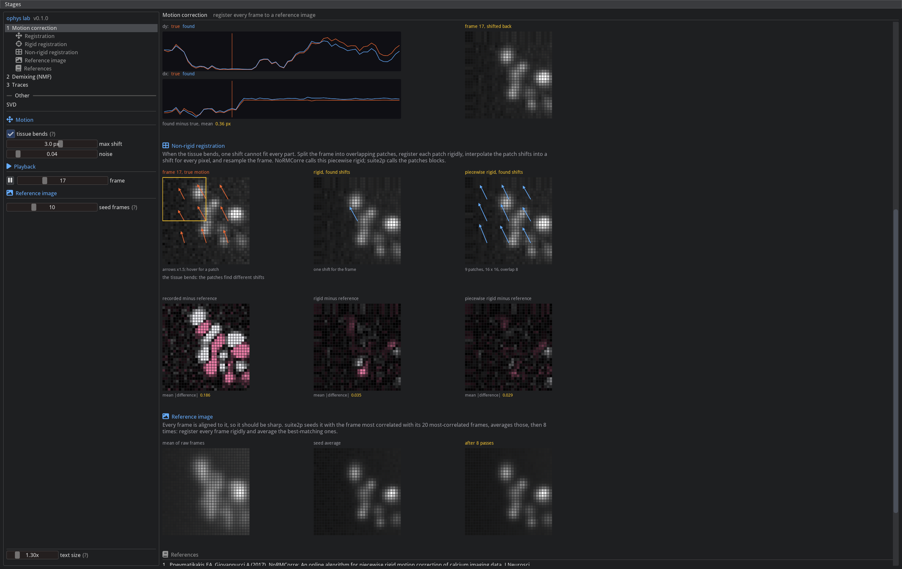
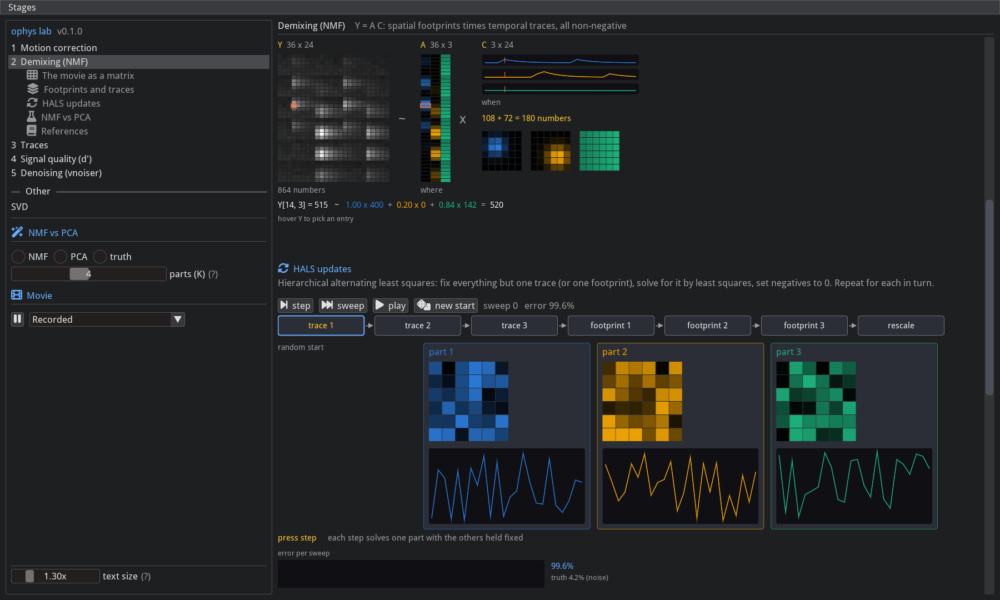
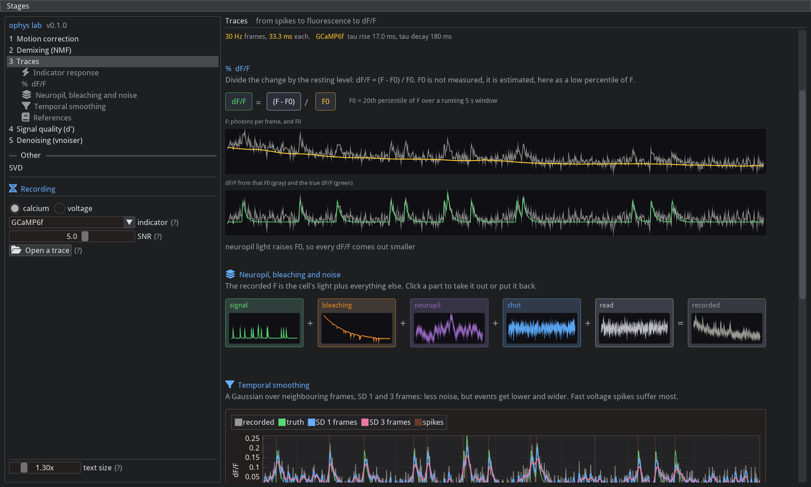
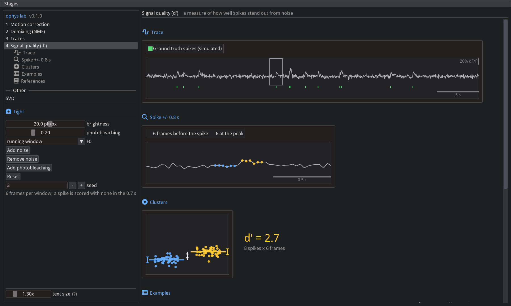

# imgui_ophys

Interactive [imgui-bundle](https://github.com/pthom/imgui_bundle) pages that explain parts of an optical physiology
pipeline with figures, on synthetic data with a known ground truth.



## Install

Run it straight from GitHub, no clone:

```bash
uvx --from git+https://github.com/FlynnOConnell/imgui_ophys imgui-ophys --app nmf
```

Or inside an environment that already has imgui-bundle (only this package is added):

```bash
uv run --with git+https://github.com/FlynnOConnell/imgui_ophys imgui-ophys --app nmf
```

From a clone:

```bash
git clone git@github.com:FlynnOConnell/imgui_ophys.git
cd imgui_ophys
uv venv -p 3.12 && uv pip install -e ".[dev]"
imgui-ophys                       # every page, rail on the left
imgui-ophys --app motion          # open on one page
python -m imgui_ophys.lessons.nmf # same, for demixing
```

The only dependencies are `imgui-bundle` and `numpy` (which ImPlot's Python API needs). The `debug` extra adds
[imgui_debugger](https://github.com/FlynnOConnell/imgui_debugger) and with it a Debug menu.

## Pages

| `--app` | page | subsections |
|---------|------|-------------|
| `motion` | Motion correction | registration; rigid registration; non-rigid (piecewise rigid) registration; reference image |
| `nmf` | Demixing (NMF) | the movie as a matrix; footprints and traces; HALS updates; NMF vs PCA |
| `traces` | Traces | indicator response; dF/F; neuropil, bleaching and noise; temporal smoothing |
| `dprime` | Signal quality (d') | trace; spike +/- 0.8 s; clusters; examples |
| `svd` | SVD (under Other) | rank-1 matrices; power iteration and deflation; truncated SVD |

Each page lists its references at the bottom.







## Text size

GLFW reports a content scale of 1 under XWayland. Set the scale in the app instead:

- Ctrl + / Ctrl - to resize, Ctrl 0 to reset to the detected scale
- the text size slider at the bottom of the left panel
- `imgui-ophys --scale 2` or `IMGUI_OPHYS_SCALE=2`

The last value is saved in `~/.imgui_ophys/settings.json`.

## Debug menu

With the `debug` extra installed, Debug > Debugger opens a live inspector on the current page's state (imgui_debugger). Style Editor, Metrics, Debug
Log and ID Stack are imgui's own tools.

## Adding a page or subsection

1. `src/imgui_ophys/lessons/<name>/model.py`: the numbers, no imgui (or use `sim.py`). Test it in `tests/`.
2. `src/imgui_ophys/lessons/<name>/view.py`: a `Lesson` subclass with `key`, `title`, `summary`, `sections` (icon,
   title per subsection) and `section_<i>()` for each, plus `controls()` for the rail. Figures from `diagram.py`,
   one-line captions, detail in tables and tooltips.
3. `__init__.py` exporting the class and `__main__.py` calling `run(["--app", "<key>"])`.
4. Add the class to `LESSONS` in `src/imgui_ophys/lessons/__init__.py`. `tests/test_headless_render.py` draws every
   subsection of every page.

See [ARCHITECTURE.md](ARCHITECTURE.md).
