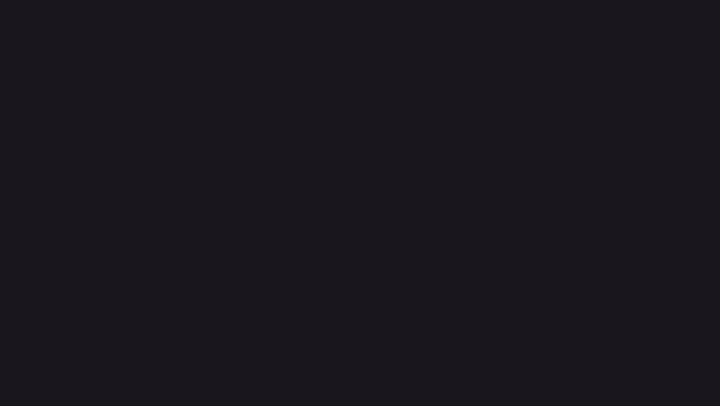
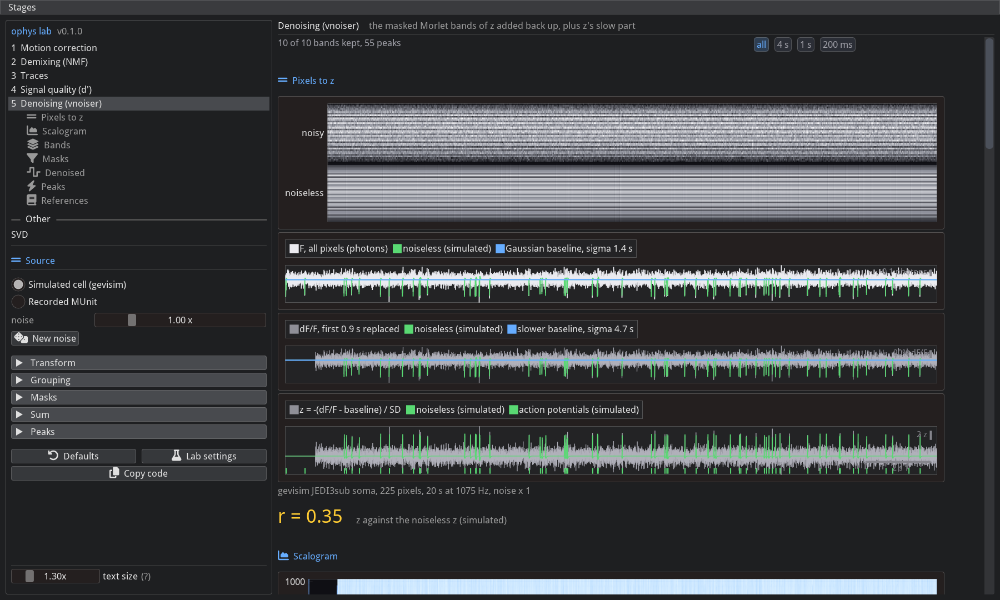
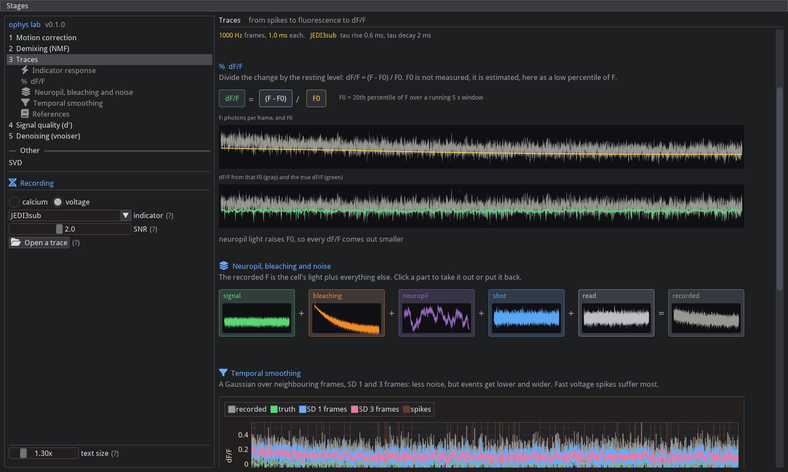

# imgui_ophys

Interactive [imgui-bundle](https://github.com/pthom/imgui_bundle) pages, one per step of an optical physiology
pipeline, on a simulated cell with a known ground truth. Each page builds its idea up in a few sections, and the
number on screen follows the picture as it changes.


## Install

Run it straight from GitHub, no clone:

```bash
uvx --from git+https://github.com/FlynnOConnell/imgui_ophys imgui-ophys --app dprime
```

From a clone, with the Denoising page (it needs the lab's [vnoiser](https://github.com/FlynnOConnell/vnoiser) and
[gevisim](https://github.com/FlynnOConnell/gevisim) checked out next to this one):

```bash
git clone git@github.com:FlynnOConnell/vnoiser.git
git clone git@github.com:FlynnOConnell/gevisim.git
git clone git@github.com:FlynnOConnell/imgui_ophys.git
cd imgui_ophys
uv venv -p 3.12 && uv pip install -e ".[dev,denoise]"
imgui-ophys                       # every page, rail on the left
imgui-ophys --app traces          # open on one page
```

The package itself depends on `imgui-bundle` and `numpy` only. The `denoise` extra adds vnoiser and gevisim with
scipy, scikit-learn and PyWavelets; without it the Denoising page says how to install it and the rest runs. The `debug`
extra adds [imgui_debugger](https://github.com/FlynnOConnell/imgui_debugger) and with it a Debug menu.

## The rail

The left rail lists the stages, the current stage's sections, and under them the one block the trace pages share:

- **calcium / voltage**, and the indicator: GCaMP6f, GCaMP6s and jGCaMP8m, or the voltage indicators
  [gevisim](https://github.com/FlynnOConnell/gevisim) models (ASAP6.1, ASAP6.2, ASAP6.3, ASAP7y, JEDI-2P, JEDI3hyp,
  JEDI3sub), each with its step response and time constants from the paper (hover the (?)).
- **SNR**: one spike's peak dF/F over the noise SD of dF/F per frame. It sets the cell's brightness; shot noise, read
  noise and neuropil follow from that.

Traces and Signal quality show the same cell. Motion correction and Demixing have their own movie and one or two
controls each (tissue bends, NMF against PCA, the number of parts). Denoising has its own source and every
parameter of the denoiser; see below.

## Pages

| `--app` | page | sections |
|---------|------|----------|
| `motion` | Motion correction | registration; rigid registration; non-rigid (piecewise rigid) registration; reference image |
| `nmf` | Demixing (NMF) | the movie as a matrix; footprints and traces; HALS updates; NMF vs PCA |
| `traces` | Traces | indicator response; dF/F; neuropil, bleaching and noise; temporal smoothing |
| `dprime` | Signal quality (d') | trace; spike +/- 0.8 s; clusters; examples |
| `denoise` | Denoising (vnoiser) | pixels to z; scalogram; bands; masks; denoised; peaks |
| `svd` | SVD (under Other) | rank-1 matrices; power iteration and deflation; truncated SVD |

Each page lists its references at the bottom.

d' follows Zhang et al. 2023 (jGCaMP8): the frames just before each isolated spike against the frames at its
response peak, pooled over spikes, (mean top - mean bottom) / pooled SD. Six frames per window for calcium, one for
voltage, where a 1 ms action potential fills one frame. The Cells buttons replay the animation's three moves: a
fifth of the light, five times the light, and five times the light with photobleaching under a whole-recording F0.

Denoising is vnoiser's Morlet wavelet denoiser, one section per stage:

    denoised = sum over bands of (band x mask) + the input's slow part

z-scored dF/F, a complex Morlet transform on 100 log-spaced scales, rows grouped into bands by PCA and Ward
clustering, a soft mask per band that opens on events, the masked bands added back up with z's slow part, and
`detect_peaks` on the trace the lab saves. Every parameter sits in the rail under its stage; a change reruns that
stage and the ones after it on a worker thread, and the stages call vnoiser's own classes, so the output matches
`Denoiser.run` (`tests/test_denoise_pipeline.py`). **Defaults** and **Lab settings** switch between `Denoiser()` and
`Denoiser.upstream`; **Copy code** copies the Python for the current settings. The time plots share one window: the
chips at the top (all, 4 s, 1 s, 200 ms) set it, and zooming any plot zooms all.

Two inputs:

- **Simulated cell (gevisim)**: one JEDI3sub soma under a two-photon point focus, 20 s at 1075 Hz, 4 spikes/s,
  its pixels' expected photons from gevisim. The one knob is **noise**: the shot noise SD relative to the simulated
  photon budget (1 is the budget, 0 the noiseless cell). With it the page shows the noiseless z beside z and counts
  how many simulated action potentials got a peak within 10 ms.
- **Recorded MUnit**: a `.mesc` unit exported by `scripts/export_mesc_linescan.py` (`roi_<i>` pixel arrays and
  `fs`), or the lab's per-ROI export (`F`, `fs`), found under `~/data` or browsed to. Pick the lines averaged into
  the domain and the window shown.

Each section ends on one number in yellow with its provenance beside it:

| section | number | high | low |
|---------|--------|------|-----|
| Pixels to z | r, z against the noiseless z | | the pixels hold little of the cell; a wandering stripe is motion |
| Bands | bands kept, and how many sit above the noise floor | the kept bands above the floor hold mostly noise; untick them under Sum | |
| Masks | events in the chosen band | windows on noise: the threshold is too low | events without a window: too high |
| Denoised | r, denoised against the noiseless z | | an event in "z - denoised" was cut |
| Peaks | peaks, and how many simulated action potentials have one within 10 ms | peaks between action potentials: the levels are too low | action potentials without one: too high |

## Animations

One animation per page, built from the same models (`animations/`). Each chapter adds one idea. Titles name the
content ("Add noise", "Truncated SVD") or are absent, traces carry scale bars instead of axes, labels state the thing
and its provenance ("Ground truth spikes (simulated)"), and a number counts along as the picture morphs.





Rebuild one with `uv run -p 3.12 animations/<page>.py --out <dir>`: the scripts declare their own dependencies
(manim, numpy, pillow) and read the pure-numpy models straight from `src/`, so nothing is added to the app's
environment. Each writes an mp4, a gif and a PNG per chapter; `kit.py` is what they share (manim through a
Cairo camera, no Scene, chapters scrubbed to any time). `--narrate` speaks one line per chapter through Kokoro
(`animations/narrate.py`, its own uv environment), stretches each chapter to its line and muxes voice and
subtitles into the mp4. The gifs here are 720 px at 10 fps; ffmpeg must be on PATH.

## Screenshots






`scripts/screenshot.py` draws every page in a hidden window into `docs/` (`--indicator JEDI3sub --suffix=-voltage`
for the voltage set); it needs PyOpenGL and pillow.

## Text size

GLFW reports a content scale of 1 under XWayland. Set the scale in the app instead:

- Ctrl + / Ctrl - to resize, Ctrl 0 to reset to the detected scale
- the text size slider at the bottom of the left panel
- `imgui-ophys --scale 2` or `IMGUI_OPHYS_SCALE=2`

The last value is saved in `~/.imgui_ophys/settings.json`.

## Debug menu

With the `debug` extra installed, Debug > Debugger opens a live inspector on the current page's state
(imgui_debugger). Style Editor, Metrics, Debug Log and ID Stack are imgui's own tools.

## Adding a page or section

1. `src/imgui_ophys/lessons/<name>/model.py`: the numbers, no imgui (or use `sim.py`). Test it in `tests/`.
2. `src/imgui_ophys/lessons/<name>/view.py`: a `Lesson` subclass with `key`, `title`, `summary`, `sections` (icon,
   title per section) and `section_<i>()` for each. Set `uses_recording = True` and implement `set_recording` if the
   page shows the rail's cell; `controls()` draws anything of its own under it, and the fewer the better. The summary
   is the quantity's definition in one line ("a measure of how well spikes stand out from noise"); section titles
   name the content, never the question ("Clusters", not "What d' says"). Figures from `diagram.py` and
   `plotting.py`: scale bars rather than axes, labels with provenance, no caption that restates the title, no
   formula prose beside a number. A parameter change morphs the picture and the number follows it (`update(dt)`,
   `animating()`), as in `dprime/view.py`.
3. `__init__.py` exporting the class and `__main__.py` calling `run(["--app", "<key>"])`.
4. Add the class to `LESSONS` in `src/imgui_ophys/lessons/__init__.py`. `tests/test_headless_render.py` draws every
   section of every page.

See [ARCHITECTURE.md](ARCHITECTURE.md).
